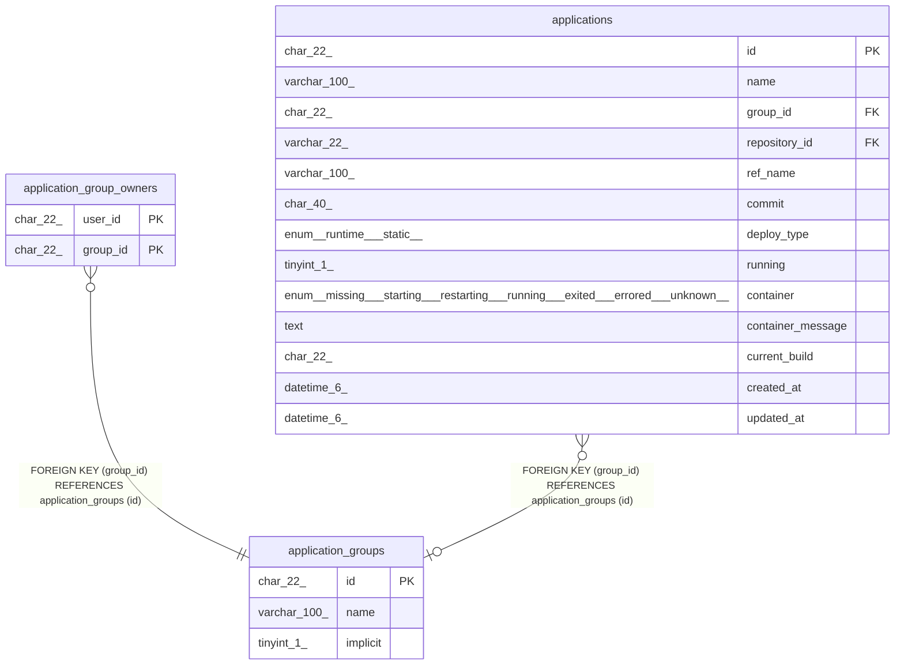

# application_groups

## Description

アプリケーショングループテーブル

<details>
<summary><strong>Table Definition</strong></summary>

```sql
CREATE TABLE `application_groups` (
  `id` char(22) NOT NULL COMMENT 'グループID',
  `name` varchar(100) NOT NULL COMMENT 'グループ名(暗黙のグループでは空)',
  `implicit` tinyint(1) NOT NULL COMMENT '1アプリのためにシステムが作った、利用者に見せないグループかどうか',
  PRIMARY KEY (`id`)
) ENGINE=InnoDB DEFAULT CHARSET=utf8mb4 COLLATE=utf8mb4_general_ci COMMENT='アプリケーショングループテーブル'
```

</details>

## Columns

| Name | Type | Default | Nullable | Children | Parents | Comment |
| ---- | ---- | ------- | -------- | -------- | ------- | ------- |
| id | char(22) |  | false | [application_group_owners](application_group_owners.md) [applications](applications.md) |  | グループID |
| name | varchar(100) |  | false |  |  | グループ名(暗黙のグループでは空) |
| implicit | tinyint(1) |  | false |  |  | 1アプリのためにシステムが作った、利用者に見せないグループかどうか |

## Constraints

| Name | Type | Definition |
| ---- | ---- | ---------- |
| PRIMARY | PRIMARY KEY | PRIMARY KEY (id) |

## Indexes

| Name | Definition |
| ---- | ---------- |
| PRIMARY | PRIMARY KEY (id) USING BTREE |

## Relations



---

> Generated by [tbls](https://github.com/k1LoW/tbls)
